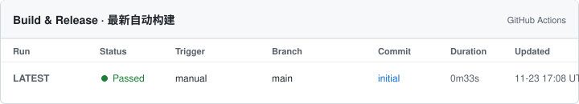

# XingJin-DripleafDupFixer

[](https://github.com/kiseTNT/XingJin-DripleafDupFixer/actions/workflows/maven.yml)
[](https://github.com/kiseTNT/XingJin-DripleafDupFixer/releases/latest)


[中文](#中文文档) · [English](#english-documentation)

---

<a id="zh"></a>

## 中文文档

轻量、零依赖的 Paper 反刷物品插件 —— 修复「残缺小型垂滴叶（Small Dripleaf）+ 骨粉催熟」产生的幽灵方块无限掉落漏洞。

**单 jar 适配 Paper 1.17.1 – 26.3 · 运行时 Java 17+ · 无需 ProtocolLib 等第三方依赖**

### ✨ 特性

- **精准拦截**：只处理残缺结构（孤立上半段 / 悬浮下半段），正常垂滴叶完全放行。
- **零消耗拦截**：在 `PlayerInteractEvent` 阶段取消骨粉右键并阻止骨粉被消耗，常数级判断。
- **五通道告警**：Title / ActionBar / Toast / Narrator / BossBar，文本与开关均可独立配置。
- **震慑特效**：音效（默认凋灵苏醒吼叫）+ 附近落雷；落雷带安全距离检测，默认纯特效、不伤实体不起火。
- **可选定时清理**：扫描并移除历史遗留的幽灵方块；异步流水线分 tick 执行，无卡顿尖峰。
- **宽版本兼容**：`api-version: 1.17`，跨版本 API 差异由兼容层处理，一个 jar 覆盖 1.17.1 – 26.3。
- **自动构建与发版**：push / PR 自动构建；推送 `v*` tag 自动创建 Release 并上传 jar。

### 📦 安装

1. 从 [Releases](https://github.com/kiseTNT/XingJin-DripleafDupFixer/releases/latest) 下载最新的 `XingJin-DripleafDupFixer-*.jar`。
2. 将 jar 放入服务端 `plugins/` 目录。
3. 启动服务端，首次运行会生成 `plugins/XingJin-DripleafDupFixer/config.yml`。
4. 按需修改配置，执行 `/dripleafdup reload` 或重启生效。

环境要求：**Paper 1.17.1+**、**Java 17+**，无其他插件依赖。

### 🧠 漏洞原理与判定

1. 利用红石 / 活塞更新跳过器（update suppression）制造残缺的小型垂滴叶：只有上半段（`Bisected.Half.TOP`），其下方不是小型垂滴叶。
2. 右键骨粉催熟时，服务端在错误方块状态下执行生长逻辑，产生幽灵方块。
3. 破坏幽灵方块时方块不被移除却持续掉落物品，从而无限刷取。

| 结构 | 条件 | 处理 |
| --- | --- | --- |
| 完整两格 | 上半段（TOP）正下方是 `SMALL_DRIPLEAF` | 放行 |
| 单格有支撑 | 只有下半段（BOTTOM），下方是实际支撑方块 | 放行 |
| 残缺 · 孤立上半段 | 上半段下方不是 `SMALL_DRIPLEAF` | 拦截 + 告警 |
| 残缺 · 悬浮下半段 | 下半段下方为空气 / 水 / 岩浆 | 拦截 + 告警 |

判定只依赖「上下相邻方块 + half 状态」，不做额外推断，因此不会误伤正常种植的垂滴叶。

### ⚙️ 配置

完整注释见 [`src/main/resources/config.yml`](src/main/resources/config.yml)。数值配错会自动夹取到安全范围，不会导致启动失败。文件编码需为 UTF-8。

| 分组 | 关键项 | 默认值 | 说明 |
| --- | --- | --- | --- |
| 基础 | `enable` | `true` | 插件总开关 |
| 基础 | `notify-player` / `notify-admin` | `true` | 玩家提示 / 在线管理员告警 |
| 扫描 | `scan-ghost-block` | `false` | 定时清理历史幽灵方块 |
| 扫描 | `scan-interval` | `300` | 扫描间隔（秒，最小 5） |
| 特效 | `effect-sound` / `effect-lightning` | `true` | 音效 / 落雷开关 |
| 特效 | `effect-lightning-effect-only` | `true` | `true` = 纯特效雷，`false` = 真实雷电 |
| 提示 | `title-*` / `action-bar-*` / `toast-*` | `true` | 各提示通道开关与文本 |
| 提示 | `narrator-*` / `boss-bar-*` | `true` | 旁白与 BossBar 的开关与文本 |

消息类配置支持占位符：`%player%`、`%uuid%`、`%world%`、`%x%`、`%y%`、`%z%`（Toast 为全服共享成就，不支持占位符）。颜色使用 `&` 格式代码。

<details>
<summary>实现细节：提示通道与异步扫描</summary>

| 通道 | 实现方式 |
| --- | --- |
| Title / Subtitle | `Player#sendTitle`，淡入 / 停留 / 淡出按 tick 配置 |
| ActionBar | `Player#sendActionBar`，持续显示时每秒自动重发 |
| Toast | 隐藏成就（`impossible` 触发器）发放后延迟撤销，兼容各版本成就 JSON |
| Narrator | `sendSystemMessage`，客户端开启旁白后朗读 |
| BossBar | 按玩家独立创建，进度条随显示时长递减 |

定时清理采用「主线程拍快照 → 异步遍历 → 主线程清理」三段流水线：每 tick 最多为 4 个区块生成 `ChunkSnapshot`，异步线程只读快照判定，主线程每 tick 最多清理 128 个结果并在清理前复查实时世界。上一轮未结束则跳过本轮，不会任务叠加；骨粉拦截始终在主线程完成。

</details>

### 💬 命令与权限

| 命令 | 说明 | 权限 |
| --- | --- | --- |
| `/dripleafdup reload`（别名 `/ddf`、`/dlfix`） | 重载配置 | `xingjin.dripleaf.admin` |

| 权限 | 说明 | 默认 |
| --- | --- | --- |
| `xingjin.dripleaf.admin` | 接收 BUG 告警并使用管理命令 | op |

### 🧪 验证

1. 正常垂滴叶：放置小型垂滴叶 → 骨粉催熟 → 正常长成两格，不被拦截。
2. 残缺方块：`/setblock ~ ~ ~ minecraft:small_dripleaf[half=top]` → 骨粉右键 → 出现拦截提示，控制台输出 `[AntiDup]` 告警。
3. 定时清理：设 `scan-ghost-block: true`、`scan-interval: 5` → `/ddf reload` → 数秒内控制台出现清理日志。

### 🚀 CI / 自动构建



*最新一次自动构建记录（快照）。实时状态以顶部 Build 徽章及 [Actions 页面](https://github.com/kiseTNT/XingJin-DripleafDupFixer/actions) 为准。*

工作流定义在 [`.github/workflows/maven.yml`](.github/workflows/maven.yml)，名称 **Build & Release**。

**触发方式**

| 触发 | 行为 |
| --- | --- |
| push 到任意分支 | 构建 jar、校验包内 `plugin.yml`、上传 Artifacts |
| Pull Request | 同上，作为 PR 检查 |
| 手动 Run workflow | 构建；填写 tag 时同时发布 Release |
| push `v*` 标签 | 构建并自动创建 Release，上传 jar 附件 |

**构建流程**

1. `actions/checkout@v4` 检出代码。
2. `actions/setup-java@v4` 安装 Temurin JDK 17，启用 Maven 缓存。
3. `mvn -B clean package` 编译打包，产出 Java 17 字节码。
4. 校验生成的 jar 内含 `plugin.yml`。
5. `actions/upload-artifact@v4` 上传 Artifacts（保留 90 天）。

**查看结果**：打开仓库 **Actions** → **Build & Release** → 最新运行。绿色 ✓ 表示通过；页面底部 **Artifacts** 中的 `XingJin-DripleafDupFixer` 即构建好的 jar，可直接下载。

**自动发版**：推送 `v*` 标签，或在 Actions 页面手动运行 **Build & Release** 并填写 tag。

```bash
git tag v1.0.0
git push origin v1.0.0
```

`Publish GitHub Release` 步骤会创建 Release 并把 jar 作为附件上传；发行说明由提交历史自动生成，带 `-` 的 tag（如 `v1.1.0-beta`）会标记为 Pre-release。

### 🛠 本地构建

```bash
mvn clean package
```

产物：`target/XingJin-DripleafDupFixer-1.0.0.jar`（需 JDK 17+ 与 Maven）。

### 📁 项目结构

```text
XingJin-DripleafDupFixer/
├── .github/
│   ├── assets/ci-runs.svg               # 最近构建记录界面图
│   └── workflows/maven.yml              # CI：构建 + 自动发版
├── pom.xml                              # Maven 构建配置
├── LICENSE                              # MIT
├── README.md
└── src/main/
    ├── java/com/xingjin/dripleafdup/
    │   ├── XingJinDripleafDupFixer.java # 主类：配置、告警、命令
    │   ├── DripleafUtil.java            # 残缺结构判定
    │   ├── Compat.java                  # 跨版本世界高度兼容
    │   ├── DripleafDupListener.java     # 骨粉交互拦截
    │   ├── GhostScanTask.java           # 异步幽灵方块清理
    │   └── NoticeManager.java           # 多通道提示
    └── resources/
        ├── plugin.yml
        └── config.yml
```

### 📄 许可证

MIT © 2026 kise_TNT。详见 [LICENSE](LICENSE)。

---

<a id="en"></a>

## English Documentation

A lightweight, zero-dependency Paper plugin that patches the small dripleaf + bone meal ghost block duplication exploit.

**Single jar for Paper 1.17.1 – 26.3 · Java 17+ runtime · No ProtocolLib or other dependencies**

### ✨ Features

- **Precise interception** — Only broken dripleaf structures (orphaned top half / floating bottom half) are blocked; normal plants are never affected.
- **No item loss** — Bone meal right-clicks are cancelled at `PlayerInteractEvent` without consuming the item; constant-time check.
- **Five notification channels** — Title, ActionBar, Toast, Narrator and BossBar, each independently configurable.
- **Deterrent effects** — Wither-spawn sound and nearby lightning with a safety-distance check; cosmetic by default (no damage, no fire).
- **Optional scheduled cleanup** — Removes existing ghost blocks via an asynchronous pipeline with no tick spikes.
- **Wide version support** — `api-version: 1.17`; cross-version API differences are handled by a compatibility layer, so one jar covers 1.17.1 – 26.3.
- **Automated CI and releases** — push / PR builds automatically; pushing a `v*` tag creates a Release and uploads the jar.

### 📦 Installation

1. Download the latest `XingJin-DripleafDupFixer-*.jar` from [Releases](https://github.com/kiseTNT/XingJin-DripleafDupFixer/releases/latest).
2. Put the jar in the server's `plugins/` directory.
3. Start the server; `plugins/XingJin-DripleafDupFixer/config.yml` is generated on first run.
4. Edit the config as needed, then run `/dripleafdup reload` or restart.

Requirements: **Paper 1.17.1+** and **Java 17+**. No other plugin dependencies.

### 🧠 Exploit and Detection

1. Redstone / piston update suppression is used to create a broken small dripleaf: only the top half (`Bisected.Half.TOP`) exists and the block below is not a small dripleaf.
2. Right-clicking it with bone meal makes the server run growth logic in an invalid block state, producing a ghost block.
3. Breaking the ghost block does not remove the block but keeps dropping items, allowing unlimited duplication.

| Structure | Condition | Action |
| --- | --- | --- |
| Full two-block plant | The block directly below the TOP half is `SMALL_DRIPLEAF` | Allowed |
| Single supported block | Only the BOTTOM half, resting on a solid support | Allowed |
| Broken · orphaned top | TOP half with no `SMALL_DRIPLEAF` below | Blocked + alert |
| Broken · floating bottom | BOTTOM half above air / water / lava | Blocked + alert |

Detection relies only on adjacent blocks and the `half` state, with no additional inference, so normally grown dripleaf is never affected.

### ⚙️ Configuration

Fully commented reference: [`src/main/resources/config.yml`](src/main/resources/config.yml). Invalid numeric values are clamped to safe ranges instead of causing startup failure. The file must be UTF-8 encoded.

| Group | Key | Default | Description |
| --- | --- | --- | --- |
| Basic | `enable` | `true` | Master switch |
| Basic | `notify-player` / `notify-admin` | `true` | Player hint / online admin alert |
| Scanning | `scan-ghost-block` | `false` | Periodically clean up existing ghost blocks |
| Scanning | `scan-interval` | `300` | Scan interval in seconds (minimum 5) |
| Effects | `effect-sound` / `effect-lightning` | `true` | Sound / lightning switches |
| Effects | `effect-lightning-effect-only` | `true` | `true` = cosmetic lightning, `false` = real lightning |
| Notices | `title-*` / `action-bar-*` / `toast-*` | `true` | Toggles and texts for each channel |
| Notices | `narrator-*` / `boss-bar-*` | `true` | Narrator and BossBar toggles and texts |

Messages support placeholders: `%player%`, `%uuid%`, `%world%`, `%x%`, `%y%`, `%z%` (Toast is a server-wide shared advancement, so placeholders are not supported there). Colors use `&` codes.

<details>
<summary>Implementation details: notification channels and async scanning</summary>

| Channel | Implementation |
| --- | --- |
| Title / Subtitle | `Player#sendTitle`, fade-in / stay / fade-out in ticks |
| ActionBar | `Player#sendActionBar`, resent every second for longer display |
| Toast | Hidden advancement (`impossible` trigger) awarded then revoked, compatible with multiple advancement JSON formats |
| Narrator | `sendSystemMessage`, read aloud when the client has narrator enabled |
| BossBar | Created per player, progress decreases with the display duration |

Scheduled cleanup uses a three-stage pipeline: main thread snapshots → async traversal → main thread cleanup. Up to 4 chunks produce a `ChunkSnapshot` per tick, the async thread only reads snapshots, and the main thread removes at most 128 results per tick after re-checking the live world. A new round is skipped if the previous one is still running; bone meal interception always runs on the main thread.

</details>

### 💬 Commands and Permissions

| Command | Description | Permission |
| --- | --- | --- |
| `/dripleafdup reload` (aliases `/ddf`, `/dlfix`) | Reload the configuration | `xingjin.dripleaf.admin` |

| Permission | Description | Default |
| --- | --- | --- |
| `xingjin.dripleaf.admin` | Receive exploit alerts and use the admin command | op |

### 🧪 Verification

1. Normal dripleaf: place a small dripleaf → apply bone meal → it grows to two blocks normally and is not blocked.
2. Broken block: `/setblock ~ ~ ~ minecraft:small_dripleaf[half=top]` → right-click with bone meal → interception message appears and `[AntiDup]` is logged to the console.
3. Scheduled cleanup: set `scan-ghost-block: true`, `scan-interval: 5` → `/ddf reload` → cleanup log appears within seconds.

### 🚀 CI / Automated Builds


*Snapshot of the latest automated build. For live status, see the Build badge above and the [Actions page](https://github.com/kiseTNT/XingJin-DripleafDupFixer/actions).*

The workflow is defined in [`.github/workflows/maven.yml`](.github/workflows/maven.yml) and named **Build & Release**.

**Triggers**

| Trigger | Behavior |
| --- | --- |
| Push to any branch | Build jar, verify `plugin.yml` inside, upload Artifacts |
| Pull Request | Same as above, as a PR check |
| Manual Run workflow | Build; publish a Release when a tag is provided |
| Push a `v*` tag | Build, create a Release and attach the jar |

**Build steps**

1. `actions/checkout@v4` checks out the code.
2. `actions/setup-java@v4` installs Temurin JDK 17 with Maven cache.
3. `mvn -B clean package` builds Java 17 bytecode.
4. Verify the generated jar contains `plugin.yml`.
5. `actions/upload-artifact@v4` uploads Artifacts (retained for 90 days).

**Results**: open **Actions** → **Build & Release** → latest run. A green ✓ means success; **Artifacts** at the bottom contains `XingJin-DripleafDupFixer`, the built jar, ready to download.

**Releasing**: push a `v*` tag, or run **Build & Release** manually and enter a tag.

```bash
git tag v1.0.0
git push origin v1.0.0
```

The `Publish GitHub Release` step creates the Release and uploads the jar. Release notes are generated from commit history; tags containing `-` (e.g. `v1.1.0-beta`) are marked as pre-releases.

### 🛠 Building Locally

```bash
mvn clean package
```

Output: `target/XingJin-DripleafDupFixer-1.0.0.jar` (requires JDK 17+ and Maven).

### 📁 Project Structure

```text
XingJin-DripleafDupFixer/
├── .github/
│   ├── assets/ci-runs.svg               # latest build overview image
│   └── workflows/maven.yml              # CI: build + release
├── pom.xml                              # Maven build config
├── LICENSE                              # MIT
├── README.md
└── src/main/
    ├── java/com/xingjin/dripleafdup/
    │   ├── XingJinDripleafDupFixer.java # main class: config, alerts, command
    │   ├── DripleafUtil.java            # broken-structure detection
    │   ├── Compat.java                  # cross-version world height support
    │   ├── DripleafDupListener.java     # bone meal interaction interception
    │   ├── GhostScanTask.java           # async ghost block cleanup
    │   └── NoticeManager.java           # multi-channel notifications
    └── resources/
        ├── plugin.yml
        └── config.yml
```

### 📄 License

MIT © 2026 kise_TNT. See [LICENSE](LICENSE).
